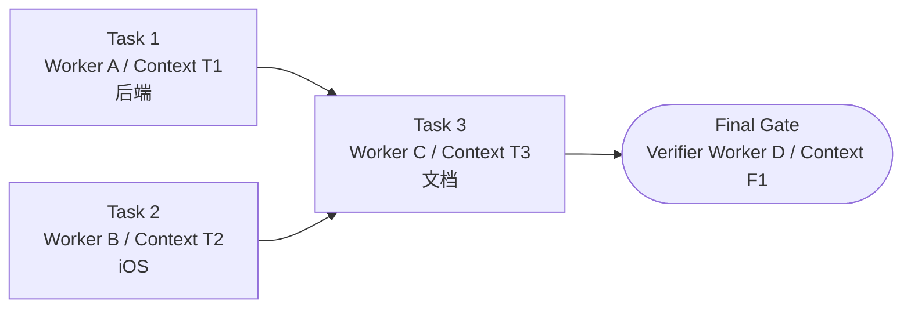

# Specs Writer Templates

固定规则见 [contract.md](contract.md)。以下只提供可复制骨架。

没有共享或过程契约时写 `契约产物：无`。

## design.md

```markdown
# <功能名>设计

> 方案状态：<待确认 / 已确认>
> 关联：<design、ADR、权威架构文档>

## 1. 目标
## 2. 非目标
## 3. 现状事实
## 4. 核心语义与不变量
## 5. 数据、接口与兼容性
## 6. 权限与状态边界
## 7. 风险与取舍
## 8. 已确认决定
```

只保留实际涉及的章节。

## plan.md

````markdown
# <功能名>实施计划

> 执行布局：execution-plan
> 方案见 `design.md`。

## 任务执行与并行策略

- 编排目标：<交付目标与执行边界>
- 执行能力：最多并发：2；每个 Task 使用独立 Worker/上下文
- 主代理边界：仅编排、派发和验收；主 Agent 不实现 Task
- Worker 输入：Task 卡；调度表对应行；design 指定章节；依赖 progress；源码入口
- Worker 回传：状态；产出契约；改动文件；验证结论；证据路径；下游可依赖；下游不可假设；风险
- 日志边界：完整日志写入 `work/evidence`；主 Agent 只读结果和路径摘要；Worker 不写 plan/progress
- 禁止回传：完整源码；完整对话；完整日志；完整 diff
- 契约冻结：C1 见 design §X，已冻结；Task 1、Task 2 只读消费
- 契约产物：C1（临时过程契约）：`docs/specs/<feature>/work/contracts/c1.json`；Task 1、Task 2；全部验收后随 `work/` 删除
- Gate 策略：无新增跨边界信号，不设 Integration Gate；Final Gate 收口证据、文档和格式

### 调度编排分析表

| Task | 范围 | 产出/消费者 | 硬依赖 | 契约 | 独占资源 |
|---|---|---|---|---|---|
| Task 1 | 后端 | 服务端接口 / Task 3 | 无 | C1 | PostgreSQL |
| Task 2 | iOS | 客户端功能 / Task 3 | 无 | C1 | Xcode 模拟器 |
| Task 3 | 文档 | 权威文档 / Final Gate | Task 1、Task 2 `AUTO_VERIFIED` | C1 | 无 |



## Task 1: <可独立验收的产出> [TODO]

### 目标

<一句话写可观察产出。>

### 约束

- 必读：design §X；契约 C1；指定源码入口
- 写入范围：<只写需修改的路径>
- 禁止修改：<禁止越界的文件或目录>

### 内容

- [ ] <执行步骤>

### 验证

- 新增信号：<本 Task 新增的可失败覆盖；消费契约时在实现期校验临时 fixture，长期测试不得读取 work/>
- 命令：<最小可执行命令>

### 交接

按 progress schema 记录产出、验证、风险和下游可依赖项。

## Task 2: <可独立验收的另一端产出> [TODO]

### 目标

<一句话写可观察产出。>

### 约束

- 必读：design §X；契约 C1；指定源码入口
- 写入范围：<只写需修改的路径>
- 禁止修改：<禁止越界的文件或目录>

### 内容

- [ ] <执行步骤>

### 验证

- 新增信号：<本 Task 新增的可失败覆盖；使用测试内最小样本校验同一契约，不依赖临时 work/>
- 命令：<最小可执行命令>

### 交接

按 progress schema 记录产出、验证、风险和下游可依赖项。

## Task 3: <可独立验收的下游产出> [TODO]

### 目标

<一句话写可观察产出。>

### 约束

- 必读：design §X；progress Task 1、Task 2；指定源码入口
- 写入范围：<只写需修改的路径>
- 禁止修改：<禁止越界的文件或目录>

### 内容

- [ ] <执行步骤>

### 验证

- 新增信号：<新增静态或行为检查>
- 命令：<最小可执行命令>

### 交接

按 progress schema 记录产出、验证和最终下游项。

<!-- 只有存在 Task 验证未覆盖的新增跨边界信号时才增加 Integration Gate。 -->

## Final Gate: 自动验证收口 [TODO]

- 执行者：Verifier Worker D / Context F1
- 依赖：Task 1、Task 2、Task 3
- 收口范围：<验收项、证据完整性和验证后变更>
- 最终命令：<真实可执行命令>
- 证据：work/evidence/final.log
- [ ] 核对最终结果

## Manual Gate: <人工验收范围> [TODO]

- 执行者：用户
- 依赖：Final Gate `PASSED`
- [ ] 完成人工验收并记录证据
````

不需要人工验收时删除 Manual Gate 及其 progress 块。容量不足只影响调度，不增加硬依赖。最终只保留三个 md，删除 `work/`；长期测试不得因删除临时契约产物而失效。

若 fixture 在验收后仍被长期测试引用，使用：

```text
- 契约产物：C1（长期测试 fixture）：<项目已有测试支持目录>/c1.json；由 Task N 写入；不随本 spec 删除
```

项目没有合适的长期测试支持目录时，先询问用户，不得自行新增仓库级共享目录。

## progress.md

```markdown
# <功能名>进度

## YYYY-MM-DD

- 状态：<实施中 / 等待人工验收 / 已完成 / 阻塞>

### Task 1 — [AUTO_VERIFIED]

- 产出契约：
- 改动文件：
- 验证命令：
- 验证结果：通过
- 证据摘要：<关键断言与结果；临时日志 work/evidence/task-1.log>
- 下游可依赖：
- 下游不可假设：
- 风险或阻塞：无

### Task 2 — [AUTO_VERIFIED]

- 产出契约：
- 改动文件：
- 验证命令：
- 验证结果：通过
- 证据摘要：<关键断言与结果；临时日志 work/evidence/task-2.log>
- 下游可依赖：
- 下游不可假设：
- 风险或阻塞：无

### Task 3 — [AUTO_VERIFIED]

- 产出契约：
- 改动文件：
- 验证命令：
- 验证结果：通过
- 证据摘要：<关键断言与结果；临时日志 work/evidence/task-3.log>
- 下游可依赖：
- 下游不可假设：
- 风险或阻塞：无

<!-- 仅在 plan 中存在 Integration Gate 时保留对应 progress 块。 -->

### Final Gate — [PASSED]

- 执行者：Verifier Worker E / Context F1
- 新增覆盖：最终证据完整性和验证后变更
- 命令：
- 结果：通过
- 证据：<最终收口结果；work/evidence/final.log>
- 结论：
- 主 Agent 确认：

### Manual Gate — [PASSED]

- 执行者：用户
- 人工验收范围：
- 人工验收结果：
- 证据：<人工验收结果；work/evidence/manual-acceptance.md>
- 结论：
- 人工决定：

- 方案review：未触发独立评审（低风险自查）
```

高风险计划完成独立评审后，把 marker 替换为独立 Reviewer 记录。主 Agent 不得用自查填写该块：

```markdown
### 方案review — YYYY-MM-DD

- 评审者：Independent Reviewer R1
- 风险级别：高
- Reviewer 结论：<PASS / CHANGES_REQUIRED / BLOCKED>
- 主 Agent 处理：<采纳、部分采纳、拒绝及理由>
- 用户决定：<确认 / 保持当前方案 / 输入意见>
- 复验：<命令与结果>
- 保留：<接受风险或 BLOCKED 时必填>
```
